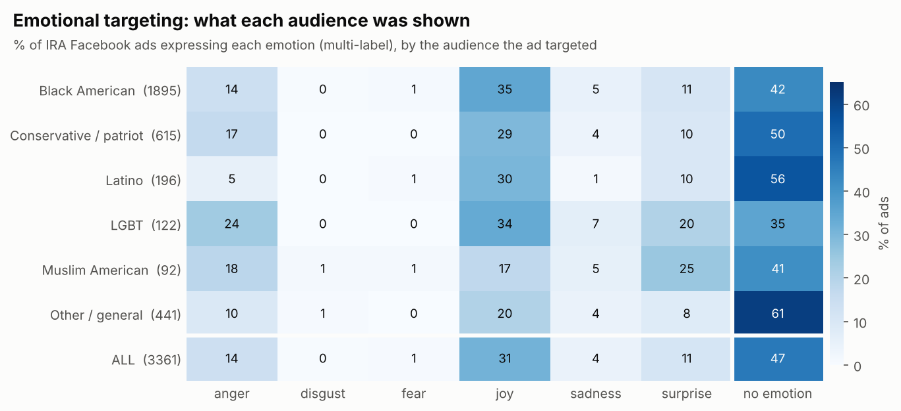
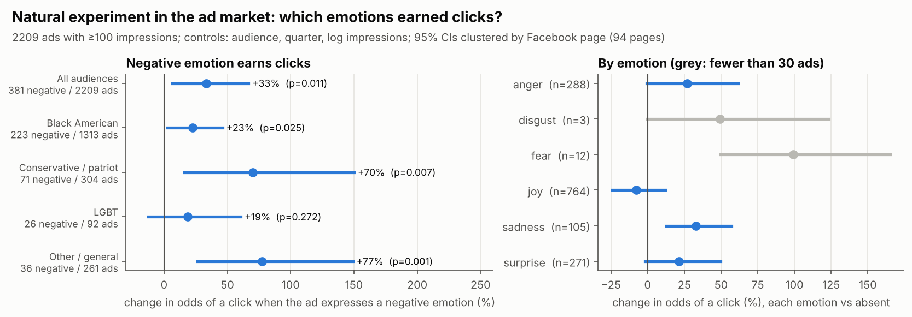
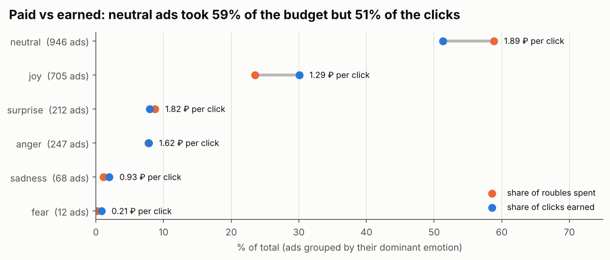
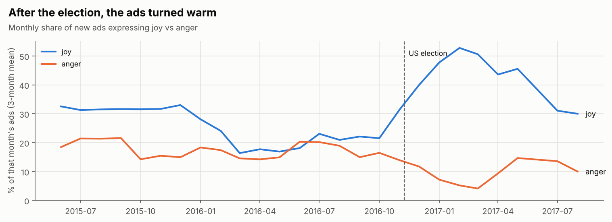
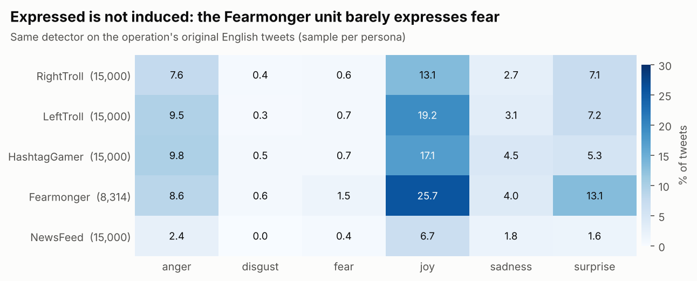
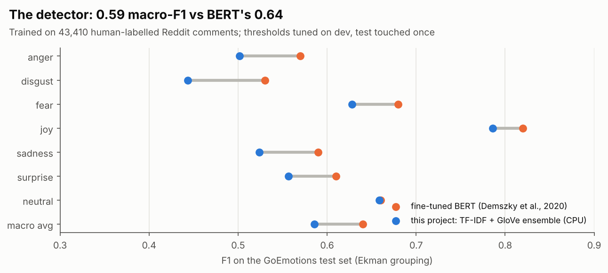

# Engineered Emotion

**Which emotions did a state-backed influence operation pay for on Facebook, which ones earned clicks, and can emotion AI be trusted to read propaganda?**

In 2018 the US House Intelligence Committee released **3,498 Facebook ads bought by Russia's
Internet Research Agency (IRA)**, with their text, targeting, impressions, clicks and cost.
Ordinary Facebook data never comes with clicks and spend attached, so this is a rare chance
to study emotion and engagement in a real influence campaign.

This project:
1. **Builds an emotion detector** for Ekman's six emotions plus neutral, trained on
   58k human-labelled comments (GoEmotions) and benchmarked against fine-tuned BERT.
2. **Maps the emotional targeting** of 3,361 text ads across the audiences they targeted.
3. **Measures which emotions earned clicks**, with audience and time fixed effects and
   page-clustered errors.
4. **Stress-tests the detector on propaganda**, and finds a systematic blind spot.



---

## Findings

### 1. Negative emotion earned clicks; joy did not

Ads expressing any negative emotion (anger, disgust, fear or sadness) had **33% higher odds
of a click** (95% CI 7–67%, p = 0.011; 2,209 ads that reached at least 100 people). Controls:
targeted audience, quarter and log impressions, with standard errors clustered by Facebook
page (94 pages). Joy carried no click advantage (p = 0.32).

The effect points the same way inside every large audience:

| Audience | Change in click odds for negative-emotion ads | p |
|---|---|---|
| Black American (1,313 ads) | +23% | 0.025 |
| Conservative / patriot (304 ads) | +70% | 0.007 |
| LGBT (92 ads) | +19% | 0.27 |
| Other / general (261 ads) | +77% | 0.001 |

Among single emotions, **sadness** has the clearest effect (+33%, CI 13–57%, n = 105), and
**anger** is borderline (+27%, p = 0.055). The +99% for fear rests on only 12 ads, so I don't
interpret it. **Robustness:** with continuous emotion intensities instead of yes/no flags,
the pooled negative effect is smaller and marginal (+15%, p = 0.065). The direction is
consistent, but the size depends on the specification.



### 2. The budget went to neutral content; the operation turned warm after the election

- **47% of ads express no emotion at all.** These are calls to events, slogans and community
  announcements. Neutral ads took **59% of the roubles but earned 51% of the clicks**, while
  joy ads took 23% of the spend and earned 30% of the clicks. These shares are raw and not
  adjusted for audience.
- **Anger was audience-specific.** It appeared in 24% of LGBT-targeted ads, 18% of Muslim
  American and 17% of conservative ads, but only 5% of Latino-targeted ads.
- **After the 2016 election, joy rose sharply.** Ads expressing joy went from 19.5% (Jan–Jul
  2016) and 23% (Aug–Election Day) to **41% between the election and January 2017**, while
  anger stayed around 13–16%. The operation shifted from provocation toward community and
  pride content.




### 3. Emotion AI reads what is expressed, not what is induced

The IRA's own Twitter unit that Clemson researchers coded as **Fearmonger**, accounts that
spread fake crises such as a Thanksgiving turkey-poisoning hoax, registers **fear in only 1.5%
of its tweets, and joy in 26%**. Reading the tweets shows why:

- **Cover traffic.** Much of what these accounts posted is friendly filler meant to look
  human ("this is very beautiful! I love it!"). The detector is right to call that joy.
- **Induced, not expressed, fear.** The hoax posts warn and ask rhetorical questions
  ("Don't eat #turkey… #KochFarms", "should we worry?"). They are built to *make readers*
  afraid without *expressing* fear themselves.

An emotion classifier trained on ordinary users measures the writer's expressed emotion.
Propaganda is engineered around the reader's emotion. **Off-the-shelf emotion AI therefore
systematically under-reads manipulative content.** That matters for every moderation or
research pipeline that uses emotion scores as a proxy for harm.



---

## The detector

| | Macro-F1, GoEmotions test set (Ekman 7) |
|---|---|
| Fine-tuned BERT (Demszky et al., 2020, Table 6) | 0.64 |
| **This project: TF-IDF + GloVe ensemble** | **0.59** |
| TF-IDF logistic regression alone | 0.59 |
| GloVe-Twitter SIF + MLP alone | 0.42 |

It reaches about 91% of BERT's score and **matches BERT on neutral (0.66)**, using models that
train in minutes on a laptop CPU. Pretrained transformers couldn't be downloaded in the
environment where this was built. Per-label thresholds and the ensemble weight were tuned on
the dev split, and the test split was used once. The TF-IDF-only model scores marginally
higher on test (0.593 vs 0.585) than the dev-selected ensemble. I kept the dev choice, since
switching after seeing test results would leak.



---

## Data and methods

- **Ads:** HPSCI release, parsed from PDFs by Ed Summers ([umd-mith/irads](https://github.com/umd-mith/irads));
  see also Simon Willison's [cleaned version](https://github.com/simonw/russian-ira-facebook-ads-datasette).
- **Audiences:** assigned from each ad's *targeting fields and page name only*, never its text,
  using transparent keyword rules tolerant of PDF-parsing noise (`src/ads.py`).
- **Emotion labels:** [GoEmotions](https://github.com/google-research/google-research/tree/master/goemotions)
  (Demszky et al., 2020), 27 fine emotions grouped into Ekman's six plus neutral.
- **Engagement model:** OLS on logit click-through rate with audience and quarter fixed
  effects and log impressions; cluster-robust errors by page family.
- **Twitter comparison:** the IRA tweet archive (FiveThirtyEight / Clemson), using the
  dataset from my project [Two Clocks](https://github.com/Zubair-DLCS/two-clocks).

## Run it

```bash
pip install -r requirements.txt
python src/run_all.py      # downloads the data, trains, analyses, draws (~8 min)
python src/validate.py     # after you label results/human_validation_sample.csv
```

The Twitter comparison (figure 6) runs only if the [Two Clocks](https://github.com/Zubair-DLCS/two-clocks) repository's dataset sits
alongside this repository; its saved results are included.

## Limitations, and the next step

- **The domain gap is not yet measured.** The detector learned from Reddit comments and is
  applied to Facebook ads. `results/human_validation_sample.csv` holds 156 ads, stratified by
  predicted emotion, ready for human labelling, and `src/validate.py` scores the detector
  against those labels. **This is the most important next step.**
- **Observational, not causal.** Emotion correlates with topic and creative choices that
  fixed effects can't fully absorb.
- **Click-through rates are unusually high** (median ≈ 10%, versus about 1% for typical
  Facebook ads). They are reported as released; how the IRA bought and targeted reach may
  explain part of this.
- **Content warning:** the ads and tweets include the operation's original divisive content.

---
